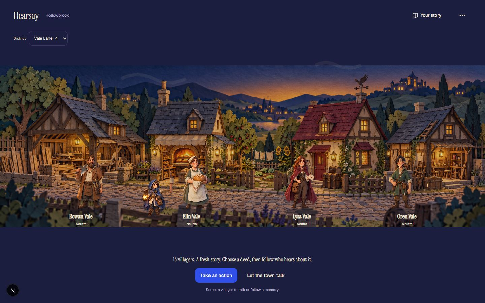
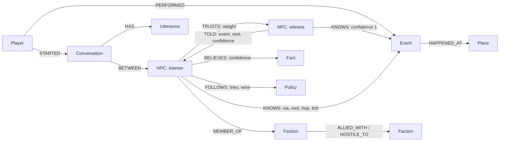
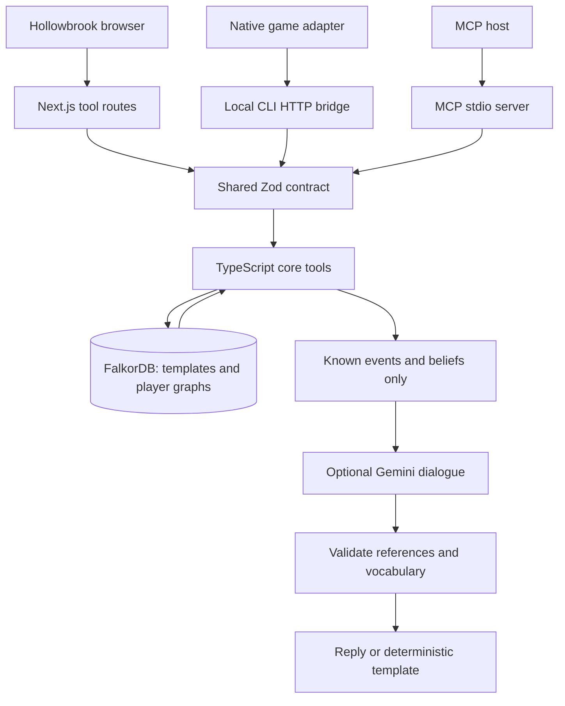
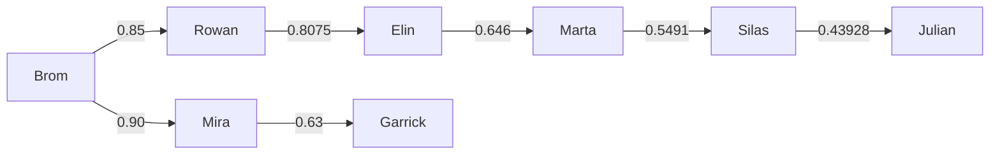
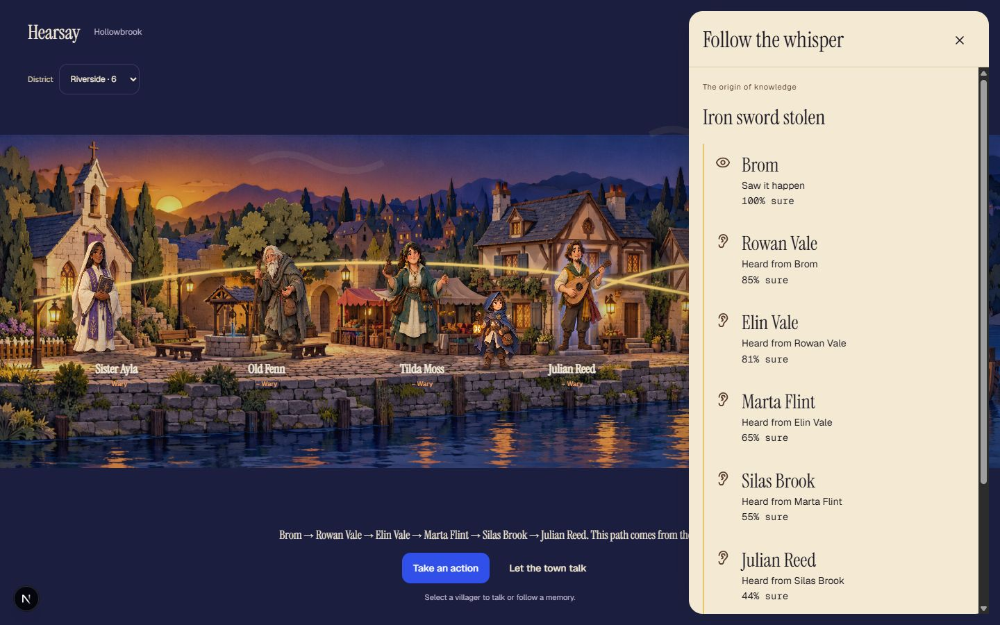

# Hearsay

**An NPC should remember what it witnessed, believe what it heard, and explain the difference.**

Hearsay is a persistent, explainable memory engine for game NPCs, built around **FalkorDB**. Player actions become events. Witnesses remember them. Rumors travel through directed trust relationships, losing credibility at every handoff. NPC attitudes depend on those memories, and dialogue is scoped to what each NPC actually knows. Ask **Why?** and Hearsay returns the stored route from witness to listener.

Built for **Graph Hacks 2026 · Track 02: Agent Memory and Coordination**. The reusable engine ships as a TypeScript workspace library, MCP server and local developer CLI. **Hollowbrook**, the playable thirteen-resident town, demonstrates the consequences.



> **Submission reminder supplied by the organisers:** make the repository public; demo the application working rather than slides; map the graph in the README; show the graph doing the work. The supplied deadline is **October 18, 2026, 11:59 PM IST = 7:29 PM WAT = 18:29 UTC**. [Organiser announcement](https://x.com/WeMakeDevs/status/2111740594485928411). The announcement could not be independently fetched during this README update; the time above matches the supplied notice and project brief.

**Submission status:** repository public; graph model, query catalogue and local setup below. A final uploaded demo-video URL and a verified public deployment URL have not been recorded here. Screenshots and local instructions are available; screenshots do not replace the required working-demo video.

## Read this first

- [Why FalkorDB is central](#why-falkordb-is-central)
- [Run locally](#run-locally)
- [Graph model](#graph-model)
- [Architecture and handoffs](#architecture-and-handoffs)
- [Gossip and provenance](#gossip-and-provenance)
- [Tool catalogue](#tool-catalogue)
- [Queries, tests and evidence](#queries-tests-and-evidence)
- [Submission checklist](#submission-checklist)

## Why FalkorDB is central

FalkorDB is the authoritative memory and relationship store. The browser renders returned state; TypeScript applies deterministic selection and scoring rules; Gemini optionally writes dialogue. Neither the UI nor the model owns the truth about who knows an event.

| Product question | Work performed by FalkorDB | What breaks without it |
| --- | --- | --- |
| Who witnessed the action? | Q30 creates an Event, its place/player links and witness KNOWS edges. | No authoritative episodic memory. |
| Who can hear next? | Q40/Q40b match KNOWS against incoming TRUSTS edges, exclude existing knowers and apply credibility thresholds. | No socially constrained gossip candidates. |
| Who actually told whom? | Q41 persists both the listener's KNOWS edge and the teller's event-specific TOLD edge. | No durable handoff history. |
| Why does Garrick know? | Q60/Q61 traverse recorded provenance; Q62 verifies links for longer fallback paths. | No evidence path to return or highlight. |
| What may an NPC discuss? | Q92/Q94 read its known events and beliefs; Q99 identifies unknown-event vocabulary for server-side checking. | No graph-derived boundary between known and unknown events. |
| How does it feel about me? | Q51 supplies that NPC's known events, confidence and traits. | The scorer loses its evidence inputs. |
| Does this save affect another? | GRAPH.COPY creates a separate player graph from a template. | The implemented save boundary disappears. |
| What behavior was learned? | Q80/Q81 read and update Policy/FOLLOWS state. | Adaptations cannot be recovered from persistent memory. |
| Who is socially influential? | Q70 runs FalkorDB's PageRank over NPC/TRUSTS. | No graph-computed hub ranking. |

**Remove FalkorDB from the live engine and these operations fail.** Template dialogue can replace Gemini; it cannot replace the database. Mock UI fixtures and the illustrated tutorial can still render without a database, but they do not demonstrate the live memory engine. Relationships could be reimplemented in another system; this repository implements and verifies them in FalkorDB.

This is a graph problem because the core questions concern connections: a listener trusts a teller, a teller knows an event, and a sequence of actual retellings connects a witness to an NPC. An unscoped event log cannot answer those questions without rebuilding the relationship and provenance machinery.

## Run locally

Use **Node 24**, Docker with a working Linux engine, and **pnpm 11.14.0**. The root package permits Node `^22.12.0 || ^24.0.0 || >=26.0.0`; Node 20 is insufficient for this checkout's toolchain.

```powershell
git clone https://github.com/Ayosensei/hearsay.git
cd hearsay
# For the README and implementation described by this submission branch:
git switch duro/submission-readme
Copy-Item .env.example .env
Copy-Item .env.example apps/web/.env.local
docker compose up -d falkordb
pnpm install
pnpm dev
```

On macOS/Linux, replace the two `Copy-Item` commands with `cp`. Install/select the pnpm version declared in root `package.json` before installing dependencies. The web-specific environment copy makes Next.js load the settings from its application directory; the root copy is used by command-line scripts. Keep both files private and update the appropriate file when changing settings.

- Play: **[http://localhost:3001](http://localhost:3001)**.
- Inspect FalkorDB: **[http://localhost:3000](http://localhost:3000)**.
- Database protocol: `localhost:6379`.
- Component specimens: **[http://localhost:3001/styleguide](http://localhost:3001/styleguide)**.

The default settings use **real FalkorDB with template dialogue**, requiring no Gemini key. `NEXT_PUBLIC_HEARSAY_MODE=live` selects the real HTTP-backed engine. `HEARSAY_LLM=off` disables only model generation. For Gemini, privately configure `GEMINI_API_KEY`, `GEMINI_MODEL` and `HEARSAY_LLM=live`, then restart the relevant process. The model is read from configuration, never hardcoded.

The server initializes missing templates from validated synthetic seed data. Existing templates and saves are not silently overwritten when a seed file changes. Resetting a player deliberately discards that player's memory.

| Setting | Purpose |
| --- | --- |
| FALKORDB_HOST / FALKORDB_PORT | Database endpoint; localhost / 6379 by default. |
| FALKORDB_USERNAME / FALKORDB_PASSWORD | Optional database credentials; empty for the supplied local container. |
| GEMINI_API_KEY / GEMINI_MODEL | Optional generation credentials and selected model. |
| HEARSAY_LLM | `off` for templates; `live` for configured generation. |
| NEXT_PUBLIC_HEARSAY_MODE | `live` for real graph calls; `mock` for UI fixture development. |
| HEARSAY_SEED_PATH / HEARSAY_TEMPLATE_GRAPH | Optional server seed/template overrides; use a compatible pair. |

## Graph model

There are two distinct template defaults: the core/CLI starter uses `seed/hollowbrook.json` and `world_template`; the web uses `seed/hollowbrook-expanded.json` and `world_template_hollowbrook13`. Both create isolated saves named `player:{playerId}`. The web uses separate browser player identifiers for the expanded edition. Template names alone do not namespace player IDs across independent applications; use dedicated database instances or coordinated IDs.



| Node | Important stored properties | Memory role |
| --- | --- | --- |
| Player | id, name, tick, createdAt | Save identity and deterministic clock. |
| NPC | id, name, role, faction, greed, courage, loyalty, persona | Identity, voice and reaction traits. |
| Event | id, type, weight, tick, at, subject | Episodic record of a player action. |
| Place | id, name | Where the event happened. |
| Faction | id, name | Social grouping and faction relations. |
| Fact | id, text, topic | Semantic world knowledge. |
| Policy | id, kind, markup, minMarkup, maxMarkup, step | Learned procedural behavior. |
| Conversation | id, tick, at | Dialogue session linked to player and NPC. |
| Utterance | id, speaker, text, tick, at, sequence | Persistent conversation continuity. |
| EventType | type, weight, keywords | Seed metadata for event weights and lexical checking. |

Properties are scalars or arrays. Scenario state uses a serialized JSON string rather than a map-valued graph property. Application IDs such as `NPC:brom` and event-specific edge IDs are stable presentation identities; internal database IDs are not exposed as save identity.

**KNOWS is a memory receipt:** `via` stores `witness` or the immediate teller; `root` stores the original witness; `hop` stores distance from that witness; `confidence` stores cumulative credibility; `tick` stores when knowledge arrived. **TOLD is the actual delivery record**, tagged with event and root so unrelated rumors cannot be joined into an explanation.

**TRUSTS points from listener to trusted teller.** `Mira → Brom, weight 0.9` means Mira trusts Brom; information travels from Brom to Mira. Trust and information arrows therefore point in opposite directions.

## Architecture and handoffs



The **Scribe** records an action, **Gossip** discovers and stores social handoffs, and the **NPC** reads its updated memories before replying. These are logical responsibilities inside the application, rather than independent autonomous processes. Their shared state is the graph. Every database operation returns a trace containing agent, tool, query ID, sanitized arguments, row count and elapsed milliseconds.

## Gossip and provenance

The actual candidate query, [Q40](queries/Q40_gossip_candidates_all.cypher), answers: **which unaware listeners trust someone who knows a sufficiently important, believable event?**

```cypher
MATCH (a:NPC)-[k:KNOWS]->(e:Event)
MATCH (b:NPC)-[t:TRUSTS]->(a)
WHERE NOT (b)-[:KNOWS]->(e)
  AND abs(e.weight) >= $minWeight
  AND k.confidence * t.weight >= $minCred
RETURN e.id AS eventId, a.id AS teller, b.id AS listener,
       k.confidence * t.weight AS cred, k.root AS root, k.hop AS hop
```

Default thresholds are `abs(event.weight) >= 0.3` and credibility `>= 0.25`. TypeScript selects the strongest candidate for each event/listener pair; equal confidence is resolved by teller ID ascending. The whole round is read before Q41 writes its chosen KNOWS/TOLD edges, so newly informed NPCs wait until the next round to tell anyone else. The write checks again that the listener is unaware and returns only actual additions.

`advanceTime` runs one round for all eligible events and advances the player's tick. `spread` explores one event up to its configured hop limit without advancing the clock. Existing knowledge is not upgraded by a later stronger route. This is deterministic rumor delivery, not a global search for the most credible possible future path.

### Follow a real expanded-town rumor

With Brom witnessing a sword theft, the thirteen-resident seed yields:

| Round | New listeners and cumulative confidence |
| --- | --- |
| 1 | Mira 90%; Rowan 85%; Ayla 50%. |
| 2 | Elin 80.75%; Lysa 68%; Oren 63.75%; Fenn 72%; Garrick 63%. |
| 3 | Marta 64.6%; Tilda 52.4875% through Elin. |
| 4 | Silas 54.91% through Marta. |
| 5 | Julian 43.928% through Silas. |
| 6 | Nobody new. |



These arrows represent **TOLD**, labelled with cumulative confidence. Julian's five-hop route is verified through the core's source-pointer walk and actual-link checks because the initial Q61 path query is bounded to four hops. See [expanded-world evidence](docs/duro/expanded-town.md).

The separate six-NPC **golden test fixture** has no Vale-family detour: tick 1 Mira 0.90/Ayla 0.50; tick 2 Fenn 0.72/Garrick 0.63; tick 3 Tilda 0.36 through Fenn; tick 4 no additions. Tilda's competing Garrick route is 0.315, so Fenn wins that round. Do not expect this six-person table from the expanded web seed or three-person CLI starter.

### An explanation is a stored path

[Q61](queries/Q61_explain_chain.cypher) traverses actual `TOLD*1..4` edges, requiring **every edge** to match the event and original witness. Q60 checks the NPC's memory first; Q62 validates individual telling links during the longer-path fallback. Missing or inconsistent provenance returns an error rather than an invented chain. A direct witness gets a one-person chain; an unaware NPC gets `status: "not_in_graph"` and an empty chain.

Returned edge IDs match `snapshot` edge IDs, allowing the UI to highlight the same evidence. A model is never asked to invent a reason for the answer.



## Attitudes, dialogue and learned behavior

Attitude is computed from graph-derived memories with a transparent formula:

```text
recency = max(0.3, 1 - 0.05 × (currentTick - eventTick))
traitFactor = weight < 0 ? 0.7 + 0.6 × loyalty : 0.7 + 0.6 × (1 - greed)
effect = weight × confidence × recency × traitFactor
score = clamp(sum(effect), -1, 1)
```

Labels are hostile at `<= -0.6`, wary at `<= -0.2`, neutral below `0.2`, friendly below `0.6`, and devoted otherwise. At tick 2, Garrick's theft memory at 0.63 confidence contributes **-0.562464 (wary)**; Brom's firsthand memory contributes **-0.7632 (hostile)**. Each contribution is returned for inspection. Confidence in a report and attitude toward the player are different values.

For `say`, the engine resolves identities, reads the NPC's known events, beliefs, attitude and recent conversation, persists the player's line, then generates or selects a reply and persists the NPC's line. Unknown events are read only for server-side checking; they are not added to the model's known-event prompt. Player speech/history is treated as unverified speech, not proof that an NPC witnessed something.

The firewall checks declared/embedded event IDs and unknown-event keywords/subject words. A violating generated response is retried once, then replaced by an event-safe template if still invalid. Model failures also use templates. Results expose source, permitted event IDs and firewall metadata. **This lexical guard is not a semantic proof against every paraphrase or prompt attack.** The graph-derived prompt boundary is the first protection; validation and fallback add another layer.

`sayNaive` deliberately gives the same dialogue model the full player event log and measures leakage without blocking. It is a demonstration control, excluded from MCP and from persistent conversation history. Template-mode comparison does not prove live-model behavior.

Procedural memory lives in Policy/FOLLOWS. Tilda's lowball outcomes increase markup by 0.05 up to 0.30; a fair outcome decreases it by 0.02 down to 0.05. Three lowballs move 0.10 → 0.25. Tries/wins persist, and updates detect intervening changes. See [behavior specification](docs/shared/06-behaviour-specs.md) and [policy evidence](docs/goodness/G8-policy.md).

## Tool catalogue

The [Zod contract](packages/contract/src/schemas.ts), version **1.0.0**, defines 15 tools. MCP exposes 14, excluding the naive control. Successful and failed calls both include a trace:

```typescript
{ ok: true, data, trace }
{ ok: false, error: { code, message, hint? }, trace }
```

| Tool | Responsibility |
| --- | --- |
| getWorld | List the configured world's NPCs, places and event types. |
| newPlayer | Copy the template into an isolated save; report whether newly created. |
| resetPlayer | Discard one player's current memory and restore template state. |
| recordEvent | Validate identities, then persist an action and 1–6 witnesses. |
| advanceTime | Spread all eligible rumors one round; increment tick. |
| spread | Spread one event within configured hop/credibility limits. |
| recall | Return an NPC's known events with source, confidence and hop. |
| attitude | Return score, label and contributing memories. |
| explain | Return the actual event-specific witness-to-listener chain. |
| whoKnows | Separate witnesses, secondhand listeners and unaware residents. |
| gossipHubs | Compute PageRank over NPC/TRUSTS. |
| adaptPolicy | Persist learned haggling markup and outcome counters. |
| say | Produce a knowledge-scoped reply with generation/firewall metadata. |
| sayNaive | Demo-only omniscient baseline with leakage measurement. |
| snapshot | Return visible nodes/edges using stable application IDs. |

Invalid input returns `BAD_ARGS`. Graph resolution distinguishes unknown players, NPCs, places, events and policies. `not_in_graph` is a successful absence of NPC knowledge, not evidence that the event never occurred. Reads use `roQuery`; intentional writes use fixed parameterized queries. The model neither writes nor receives Cypher.

### TypeScript integration

Run within this workspace or a project configured to resolve its packages. `@hearsay/core` is a private workspace package; this example is not a claim that it is separately published on npm.

```typescript
import { connectDatabase, createHearsay } from "@hearsay/core";

const connection = await connectDatabase();
if (!connection.ok) throw new Error(connection.error.message);
const hearsay = createHearsay(connection.data);
try {
  await hearsay.call("newPlayer", { playerId: "demo" });
  const event = await hearsay.call("recordEvent", {
    playerId: "demo", type: "stole", placeId: "forge",
    witnesses: ["brom"], subject: "iron sword",
  });
  if (!event.ok) throw new Error(event.error.message);
  await hearsay.call("advanceTime", { playerId: "demo" });
  await hearsay.call("advanceTime", { playerId: "demo" });
  console.log(await hearsay.call("explain", {
    playerId: "demo", npcId: "garrick", eventId: event.data.eventId,
  }));
} finally {
  await connection.data.close();
}
```
